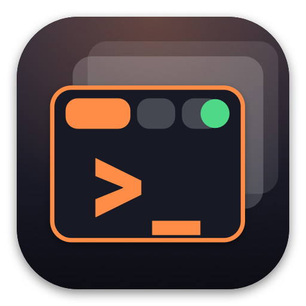
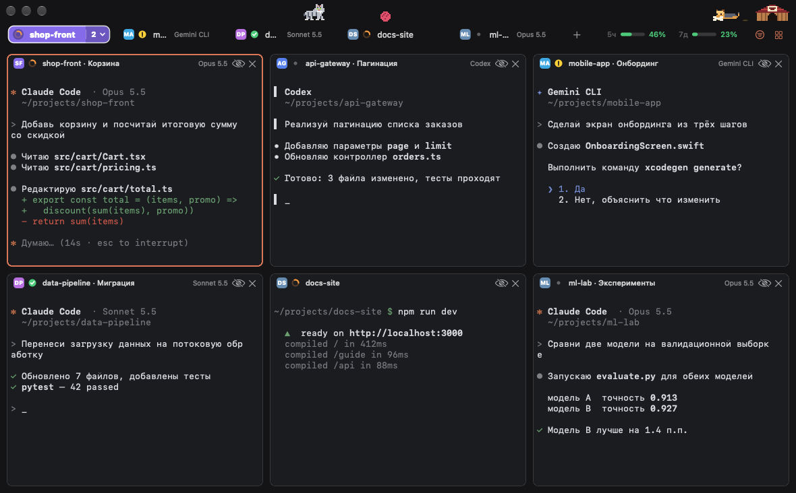
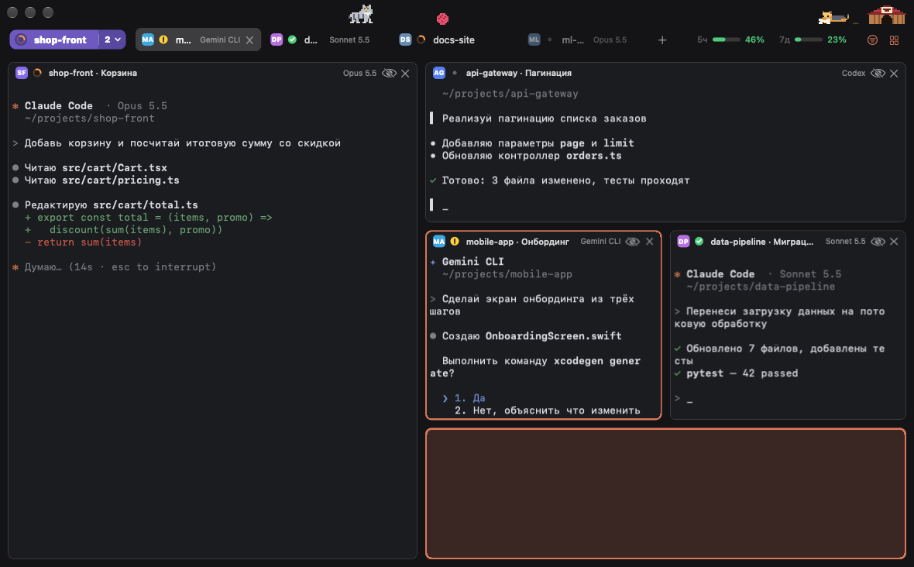
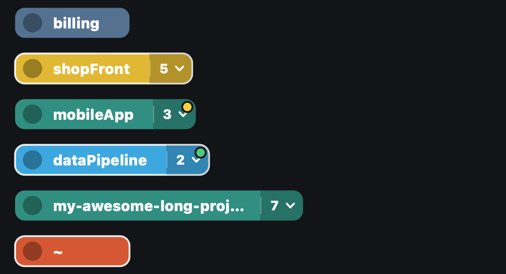
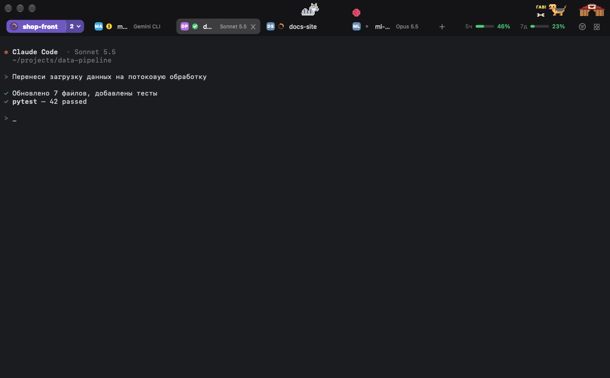
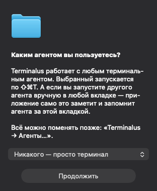
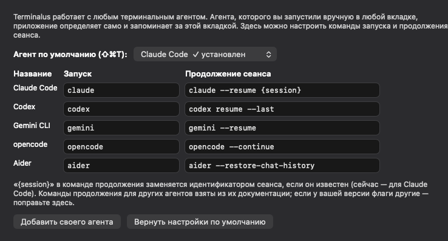
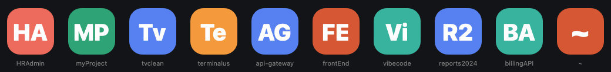
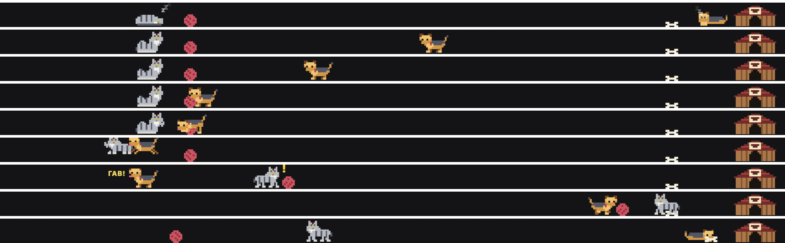
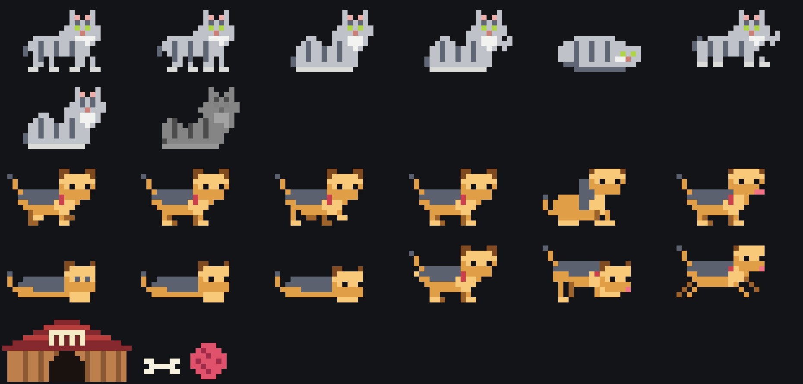

<p align="center">
  
</p>

<h1 align="center">Terminalus</h1>

<p align="center">
  <b>Терминал для macOS, созданный для работы с Claude Code:</b><br>
  вкладки как в браузере, сетка из живых окон, статусы агентов, лимиты, архив вкладок<br>
  и два питомца, которые следят за вашей работой 🐈🐕
</p>

<p align="center">
  
  
  
  
</p>

<p align="center">
  
</p>

---

## Зачем

Когда параллельно работает несколько агентов Claude, обычный терминал превращается в кашу из окон.
Terminalus собирает всё в **одно окно**: вкладки для переключения, **сетка** для обзора, понятные **статусы**
(работает / ждёт ответа / закончил), **лимиты подписки** прямо в панели и **«архив»**, чтобы держать открытыми
десятки вкладок и не платить за них памятью.

## Установка и сборка

Нужны macOS 13+ и Xcode Command Line Tools (`xcode-select --install`). SwiftPM не используется — сборка идёт скриптом напрямую через `swiftc`.

```bash
git clone https://github.com/Gepackstuck/Terminalus.git
cd Terminalus
./build.sh run            # соберёт build/Terminalus.app и запустит
```

| Команда | Что делает |
|---|---|
| `./build.sh` | собрать `build/Terminalus.app` под архитектуру вашего Mac |
| `ARCHS="arm64 x86_64" ./build.sh` | универсальная сборка (Apple Silicon + Intel) |
| `REBUILD_DEPS=1 ./build.sh` | пересобрать SwiftTerm |

Приложение подписано ad-hoc, поэтому на чужом Mac macOS может спросить подтверждение при первом запуске
(«Системные настройки → Конфиденциальность и безопасность → Всё равно открыть»).

### Лимиты и модель Claude
При первом запуске нажмите «Лимиты: подключить» в панели вкладок: приложение (с вашего подтверждения) добавит `statusLine`
в `~/.claude/settings.json`, предварительно сохранив копию. Скрипт ничего не печатает в интерфейс Claude Code и только сохраняет данные
в `~/Library/Application Support/Terminalus`.

## Возможности

### Вкладки и сетка
- **Вкладки как в браузере**: перетаскивание для смены порядка, закрытие с подтверждением, если во вкладке что-то выполняется.
- **Режим сетки** (`⇧⌘G`): все терминалы живые и видны одновременно.
  - окна можно ставить **как угодно** — бросьте шапку окна на сторону другого окна, на центр (поменять местами) или на край сетки (колонка/строка на весь размер); место вставки подсвечивается, остальные окна плавно разъезжаются;
  - границы между окнами **тянутся мышью**, двойной клик выравнивает;
  - выбирайте, какие вкладки показывать в сетке; скрытую вкладку открывает двойной клик, а кнопка «К сетке» возвращает обратно.
<p align="center"></p>
<p align="center"><sub>Свободная раскладка: одно высокое окно слева, остальные справа; пустая подсвеченная рамка — место, куда встанет перетаскиваемое окно. Скрытая из сетки вкладка в списке приглушена.</sub></p>

- **Закреплённые вкладки** собираются в «стопку» слева: виден один цветной бейдж с полным названием, остальные — в списке по стрелке; точка на стрелке сообщает, что на скрытой вкладке что-то случилось.

<p align="center"></p>
<p align="center"></p>

### Любой агент, не только Claude
Terminalus не привязан к одному агенту. **При первом запуске** он спрашивает, каким агентом вы пользуетесь (выбранный запускается по `⇧⌘T`).
А если вы запустите **другого агента вручную** в любой вкладке — приложение само это заметит (по процессу на переднем плане) и **запомнит агента за этой вкладкой**:
на вкладке появится его название, а при пробуждении из архива и после перезапуска сеанс продолжится нужной командой.

<p align="center"> </p>

- Из коробки: **Claude Code**, **Codex**, **Gemini CLI**, **opencode**, **Aider**; можно добавить своего агента с любой командой («Terminalus → Агенты…»).
- Команды продолжения сеанса: `claude --resume <id>`, `codex resume --last`, `gemini --resume`, `opencode --continue`, `aider --restore-chat-history` (последняя — по стороннему источнику, при необходимости поправьте в настройках).
- Лимиты и модель сейчас умеет показывать только Claude Code; если Claude не используется, виджет лимитов скрыт.

### Статусы, уведомления, лимиты
- **Индикатор у каждой вкладки**: 🟠 работает (вращается), 🟡 ждёт вашего ответа (запрос разрешения), 🟢 завершилось, ⚪ ожидание, ☾ в архиве.
- **Системные уведомления** и бейдж в Dock, когда задача закончилась или Claude ждёт ответа, а вы смотрите в другое место.
- **Лимиты подписки** (5 часов и неделя) и **модель** Claude (`Opus 5.5` и т. п.) с процентом контекста — прямо в панели; данные берутся из `statusLine` Claude Code.
- **Название папки** у каждой вкладки; цветной бейдж с инициалами, разбор `camelCase`:

<p align="center"></p>

### «Архив» для закреплённых вкладок
Закреплённые вкладки — это «архив для дальнейшего использования». Если к такой вкладке не прикасались 40 минут и в ней ничего не происходит,
процессы завершаются, а память освобождается; вкладка и бейдж остаются. Клик — и за 2–5 секунд поднимаются оболочка в той же папке и
`claude --resume <id сеанса>`. Обычные вкладки никогда не усыпляются.

### Удобство и привычные сочетания macOS
- Работают сочетания редактирования текста: `⌥←/→`, `⌘←/→`, `⌥⌫`, `⌘⌫`, `⌥⌦`, `⌘⌦`, `Home/End`, `⌘Z`; `⇧↩` — новая строка в поле Claude Code.
- **Перетащите папку или файл** из Finder в терминал — путь вставится с экранированием.
- **⌘V со скриншотом** в буфере отправляет картинку в Claude Code.
- Размер шрифта меняется **для каждой вкладки отдельно** (`⌘+`, `⌘−`, `⌘0`).
- Новые вкладки открываются в общей папке (`~/Documents/vibecode`), а `⌥⌘T` — в папке текущей вкладки.
- Вкладки восстанавливаются после перезапуска: папки, порядок, раскладка сетки, цвета, закрепления; сеансы Claude возобновляются.

### Питомцы 🐈🐕
В строке заголовка живут **Тян** (серебристая полосатая кошка) и **Бэн** (йоркширский терьер) с будкой.
Они реагируют на работу агентов: Тян гоняет клубок, пока Claude работает; Бэн грызёт кость, спит, лает («ГАВ!» — только визуально),
метит углы; когда агенты молчат, они устраивают догонялки. Клик — погладить, двойной клик по Тян — позвать Бэна играть.
Два стиля — **пиксельный** (по умолчанию) и векторный; экономный режим на 15 кадров в секунду. Настройки — в меню «Terminalus → Питомцы».

<p align="center"></p>
<p align="center"></p>

<sub>Картинки в этом README — отрисовка настоящих видов приложения с вымышленными проектами и текстом (`./scripts/make_screenshots.sh`), а не снимки экрана.</sub>

## Горячие клавиши

| Действие | Клавиши |
|---|---|
| Новая вкладка / с агентом по умолчанию | `⌘T` / `⇧⌘T` |
| Новая вкладка в папке текущей / с агентом | `⌥⌘T` / `⇧⌥⌘T` |
| Закрыть вкладку | `⌘W` |
| Выбрать вкладку | `⌘1`…`⌘9` |
| Следующая / предыдущая | `⇧⌘]` / `⇧⌘[`, `⌘⌥→` / `⌘⌥←`, `⌃⇥` |
| Режим сетки | `⇧⌘G` |
| Шрифт вкладки | `⌘+` / `⌘−` / `⌘0` |
| Очистить экран | `⌘K` |
| Шрифт по умолчанию | `⌘,` |

## Как это устроено

```
Sources/Terminalus/
├── MainWindowController   окно, вкладки, режимы, сохранение состояния, архив
├── TerminalSession        один терминал: процесс, статус, папка, модель, сон/пробуждение
├── TabBarView / PinnedStackView   панель вкладок и «стопка» закреплённых
├── GridView / GridLayout  сетка: дерево разбиений, перетаскивание, анимации
├── CatView + CatArt/DogArt/PixelArt   питомцы (вектор и пиксели)
├── Agents / AgentsWindow  профили агентов, определение по процессу, настройки и вопрос при первом запуске
├── Limits                 лимиты и модель из statusLine Claude Code
└── Notifier, FolderBadge, StatusDotView, …
Vendor/SwiftTerm           эмулятор терминала (v1.20.0, MIT) + наш патч, см. Vendor/PATCHES.md
```

Статус вкладки определяется по трём признакам: спиннер в заголовке терминала, наличие «настоящего» вывода (эхо набираемого текста не считается)
и запрос разрешения на экране. Данные о модели приходят из `statusLine` по отдельному файлу на каждую вкладку
(вкладка передаёт свой идентификатор через `TERMINALUS_TAB_ID`).

## Производительность

Замеры на Apple M2 Max (10 вкладок):

| Что | Стоимость |
|---|---|
| Питомцы, 15 кадров/с, пиксельный стиль | ≈ 0,2–0,3 % одного ядра |
| Секундная проверка состояния всех вкладок (папка, процесс, экран) | ≈ 0,05 % одного ядра |
| Терминалы | Metal (GPU), перерисовка только по запросу |
| Простаивающая вкладка с Claude | основной расход — сам процесс `claude`: 250–550 МБ памяти, ~0 % CPU |

Чтобы десятки открытых вкладок не занимали память, закреплённые вкладки уходят в **архив** (см. выше).

## Планы

- Поиск по выводу (`⌘F`) и по всем вкладкам
- Сплиты внутри вкладки
- Живое превью `localhost` рядом с Claude
- Разрешить запрос Claude прямо из уведомления
- Готовый `.dmg` и автообновление

Полная история изменений — [`Resources/CHANGELOG.md`](Resources/CHANGELOG.md) (она же показывается в «О Terminalus»).

## Благодарности

- [SwiftTerm](https://github.com/migueldeicaza/SwiftTerm) — эмулятор терминала (MIT).
- Сделано вместе с [Claude](https://claude.com/claude-code).
